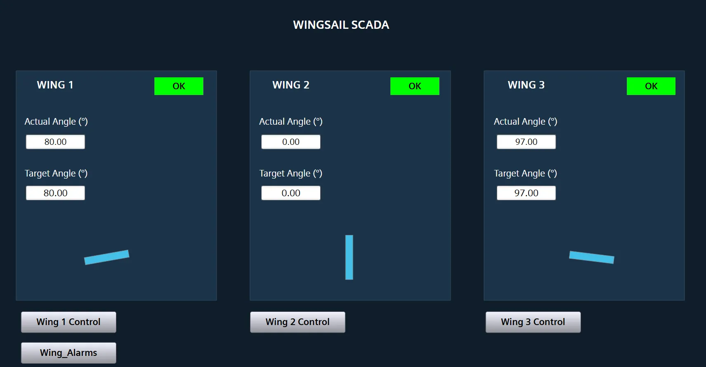
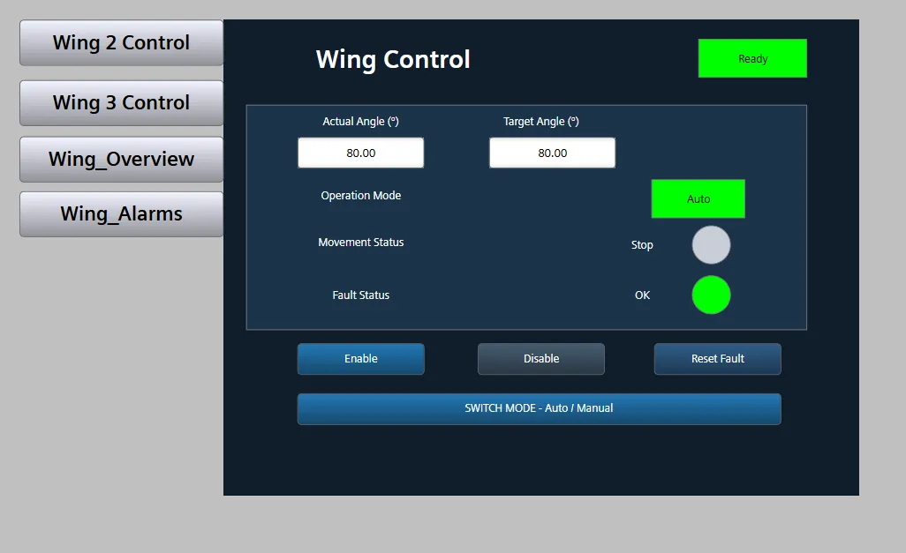
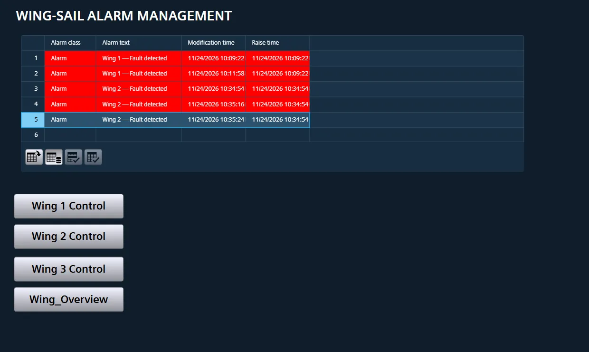

# WingSail SCADA — Siemens WinCC Unified & S7-1500

> An independently developed, simulation-based industrial HMI/SCADA demonstration for monitoring and controlling three wing-sail positioning units.



## Overview

**WingSail SCADA** is a personal automation portfolio project built in **Siemens TIA Portal V21**. It uses an **S7-1500 PLC model**, **S7-PLCSIM**, and **WinCC Unified PC Runtime** to demonstrate real-time HMI visualization, operator control, reusable faceplates, dynamic animations, discrete alarms, and alarm historization.

The project is a **simulation and learning exercise**, not a production-ready marine control or safety system. It is not an official product of, or affiliated with, any wing-sail manufacturer.

## Screenshots

### 1. Multi-wing overview


Each panel displays the actual and target angles, a dynamically rotating graphic, and an independent fault indicator. Navigation buttons open individual wing controls and alarm management.

### 2. Reusable wing-control faceplate



The same reusable faceplate type is instantiated for each of the three wings. The operator can view readiness, AUTO/MANUAL mode, movement/fault states, change the angle setpoint, enable/disable movement, and request fault reset.

### 3. Alarm management and history



Three HMI discrete alarms are driven by each wing's PLC fault state. The Alarm Control displays current and logged events with timestamps; logging uses the configured alarm archive.

## Technology stack

| Component | Technology |
|---|---|
| Engineering platform | Siemens TIA Portal V21 |
| PLC | SIMATIC S7-1500 — CPU 1511-1 PN (project configuration) |
| PLC programming | SCL (Structured Control Language) |
| PLC simulation | S7-PLCSIM |
| HMI / SCADA | WinCC Unified PC Runtime |
| Communications | Configured S7-1200/1500 symbolic HMI connection |
| Reuse | PLC UDT, structured DB, HMI faceplates and text lists |
| Alarms | Discrete HMI alarms + WinCC Unified alarm log |

## Functional features

- Independent angle setpoints and simulated actual-angle movement for **three wings**.
- PLC structures created with `UDT_Wing` and stored as `DB_Wings.Wing_1`, `.Wing_2`, and `.Wing_3`.
- `FC_SimulateWing` executed for all three wings from `OB_WingSimulation` (100 ms cyclic interrupt).
- Reusable `FP_WingControl` with ready, mode, motion and fault indications plus operator commands.
- Reusable `FP_WingFaultStatus` for the overview fault badges.
- Actual-angle-driven wing rotation and symbolic HMI tag mappings.
- AUTO/MANUAL and fault text/color changes using faceplate tags and text lists.
- Alarm detection, acknowledgment interface, and logged alarm history.
- Navigation between overview, wing-control and alarm screens.

## Architecture

```text
S7-1500 PLC / PLCSIM
  UDT_Wing
  DB_Wings
    ├── Wing_1 : UDT_Wing
    ├── Wing_2 : UDT_Wing
    └── Wing_3 : UDT_Wing
  FC_SimulateWing   <- called by OB_WingSimulation every 100 ms
          │
          │ symbolic S7 connection
          ▼
WinCC Unified PC Runtime
  Wing_Overview      <- angles + rotation + fault faceplate
  Wing_1_Control     <- FP_WingControl → Wing_1
  Wing_2_Control     <- FP_WingControl → Wing_2
  Wing_3_Control     <- FP_WingControl → Wing_3
  Wing_Alarms        <- current and logged alarms
  Log_WingAlarms     <- alarm archive
```

## PLC data structure

`UDT_Wing` contains (as developed in the simulation):

| Variable | Type | Purpose |
|---|---|---|
| `Angle_Setpoint` | `Real` | Requested angle |
| `Angle_Actual` | `Real` | Simulated actual angle |
| `Auto_Mode` | `Bool` | Operating mode |
| `Enable_Command` | `Bool` | Enable / disable movement |
| `Moving` | `Bool` | Simulated movement state |
| `Fault` | `Bool` | Active fault |
| `Simulate_Fault` | `Bool` | Fault-injection test |
| `Reset_Fault` | `Bool` | Fault reset request |
| `Ready` | `Bool` | Enabled AND AUTO AND no active fault |

See [PLC logic notes](docs/PLC-logic-reference.md) for the verified readiness expression and a description of the simulation. The complete authoritative SCL export should be added from TIA Portal rather than recreated from screenshots.

## Project files and documentation

- [Full step-by-step PDF project guide](docs/WingSail_SCADA_Complete_Project_Guide.pdf) — screenshots, setup, troubleshooting and test sequence.
- [Architecture and implementation notes](docs/architecture-and-implementation.md).
- [PLC logic reference](docs/PLC-logic-reference.md).
- [`screenshots/`](screenshots/) — three Runtime screenshots.
- [`tia-project/`](tia-project/) — instructions for adding your actual `.zap21` archive.

**Note:** This repository starter contains documentation and screenshots. **It does not yet contain the real TIA Portal project archive or complete original PLC source exports.** To make it reproducible, export and add those from your own TIA Portal project.

## Open the TIA Portal project

1. In TIA Portal V21, archive `WingSail_SCADA` as a `.zap21` file (Project → Archive, menu wording may vary).
2. Place the resulting archive in [`tia-project/`](tia-project/), provided it is safe and appropriate to publish.
3. In TIA Portal V21, retrieve/open the archive and verify installed PLC/HMI components.
4. Use PLCSIM and WinCC Unified PC Runtime for simulation. A correctly configured Siemens installation/license may be required.

Avoid publishing passwords, credentials, real customer/device identifiers, configuration secrets, or proprietary engineering assets. This project was created for demonstration, and its simplified protection settings should **not** be copied into operational deployments.

## Example demo sequence

1. Open `Wing_Overview` and demonstrate the three live wing positions.
2. Open `Wing_1_Control`, enter a new target angle and enable movement.
3. Show the actual angle and animated wing following the setpoint.
4. Switch AUTO/MANUAL and explain the Ready state.
5. Simulate a fault, inspect the fault badge and open `Wing_Alarms`.
6. Acknowledge/reset the fault, then show the recorded event in alarm history.

## Lessons learned

- Interface tags make one faceplate usable with different PLC structures.
- Symbolic PLC–HMI mapping makes structured tag updates easier to manage.
- Library type **release/update** is distinct from editing an instance.
- A faceplate's canvas must be sized to its content, or an oversized empty area appears when inserted.
- HMI alarm acknowledgment and PLC fault reset are separate operations.
- Table columns, styles and toolbars may require different configuration sections in WinCC Unified.

## Development context

Built as a personal hands-on WinCC Unified / PLC simulation project in November 2026. All screenshots are from the my development.
